# Dynamic Island for Windows

把 macOS 灵动岛带到 Windows 桌面：番茄钟、喝水、音乐与歌词、邮件验证码、AI 额度和音频设备切换，都收进屏幕顶部一枚始终置顶的胶囊里。

_A dynamic island for Windows 10/11 — pomodoro, water, media & lyrics, mail codes, AI quota and audio device switching in one always-on-top capsule._

Tauri 2 · Rust · React 19 · TypeScript · WebView2 · [MIT License](LICENSE)

[](https://github.com/dkj-duan/dynamic-Island/actions/workflows/quality.yml)
[](LICENSE)
[](#环境要求)

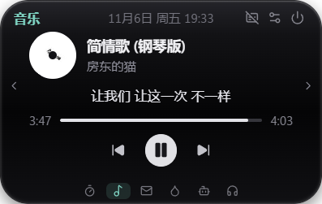

## 功能

**灵动岛**

- 收起态按内容自适应宽度，悬停或点击展开；可设置鼠标离开后「立即 / 1 / 3 / 5 / 10 / 15 秒」收起。
- 空闲时自定义显示哪些组件：时钟、喝水进度、番茄进度（今日个数 / 专注分钟 / 本轮轮次）、常驻额度环、正在播放、电池与充电、今日专注、连续专注、音量与静音、蓝牙耳机电量、喝水倒计时、倒计时；最多同时显示 6 个，可勾选并在预览里拖动排序。
- 可在「设置 → 外观 → 胶囊」添加动态小岛伙伴，并调整它的显示顺序；系统开启减少动画时使用静态形象。
- 展开后按页展示计时器、音乐、邮件、喝水、AI 额度、设备，可用两侧箭头、底部圆点或拖动面板标题切换；设备页可直接切换默认扬声器与麦克风。
- 常驻置顶、可拖动并记住位置；岛始终为深色，浅色 / 深色主题只作用于设置窗口。
- 按屏幕逻辑宽度自动分级字号与面板尺寸，适配 2K / 4K 与 Windows 缩放。

**设置窗口**

- 外观：主题（跟随系统 / 浅色 / 深色）、语言（简体中文 / English）、桌面实时预览、闲时组件管理。
- 交互：展开方式、自动收起、恢复默认位置、开机自启动、音乐页的「岛上歌词」开关。
- 提醒：提醒动效，以及验证码、喝水、计时结束时是否自动展开面板。
- 番茄钟 / 喝水提醒：3D 主视觉卡片、可配置参数与近 30 天统计图表。
- 倒计时：目标时间或固定时长，可启用一条显示在空闲胶囊。
- 系统状态：音量、亮度、电源、蓝牙提示，以及输出/输入音频设备切换。
- 邮箱提醒、AI 额度、数据与存储、关于。

## 截图

### 灵动岛

<table>
  <tr>
    <td><br><sub>收起：闲时组件（时钟 · 喝水 · 番茄 · 额度 · 音乐）</sub></td>
    <td>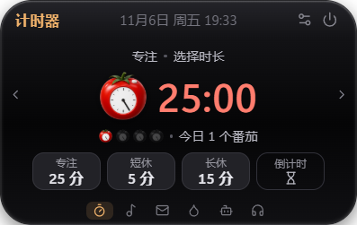<br><sub>展开：番茄钟</sub></td>
  </tr>
  <tr>
    <td><br><sub>展开：音乐与同步歌词</sub></td>
    <td>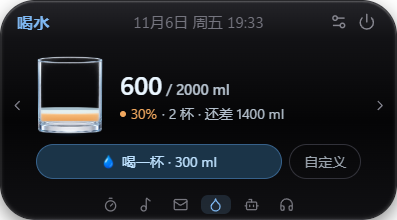<br><sub>展开：喝水进度与一键记录</sub></td>
  </tr>
  <tr>
    <td><br><sub>展开：邮件提醒（暂无新邮件）</sub></td>
    <td>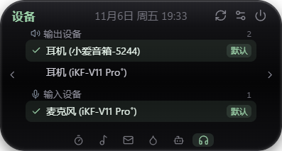<br><sub>展开：输出与输入设备切换</sub></td>
  </tr>
</table>

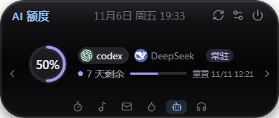
<br><sub>展开：AI 额度（多账户切换 · 环内百分比 · 重置时间）</sub>

### 设置窗口

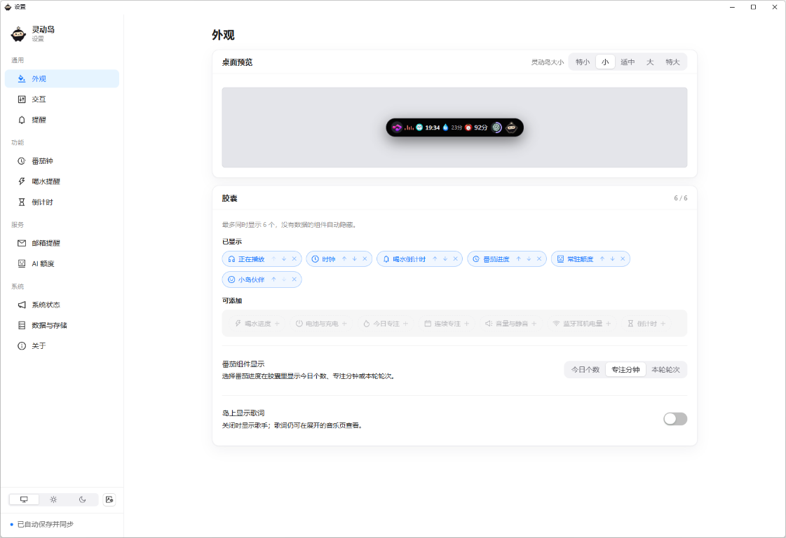

<details>
<summary>更多设置页截图</summary>

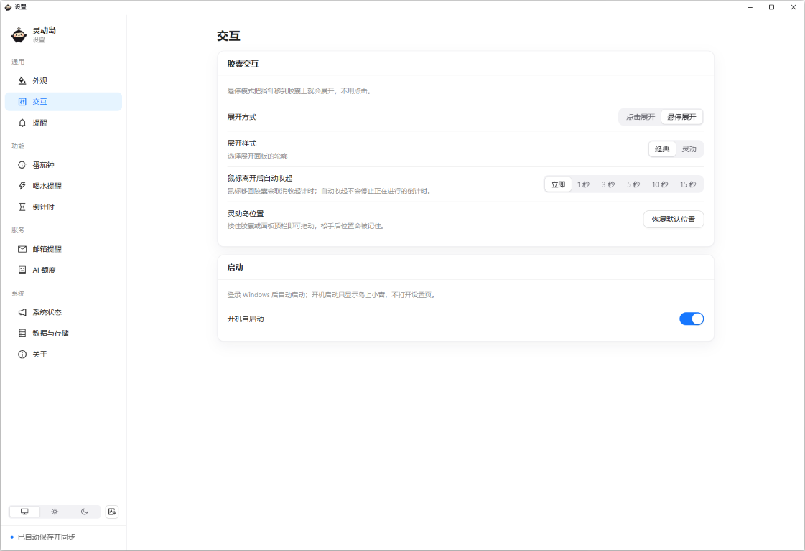

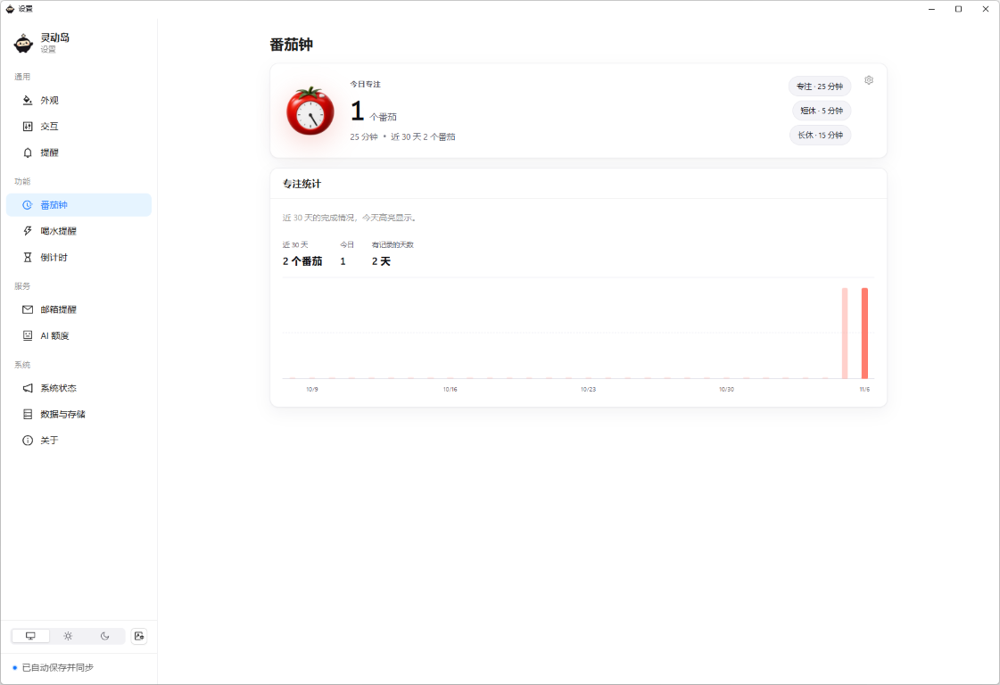

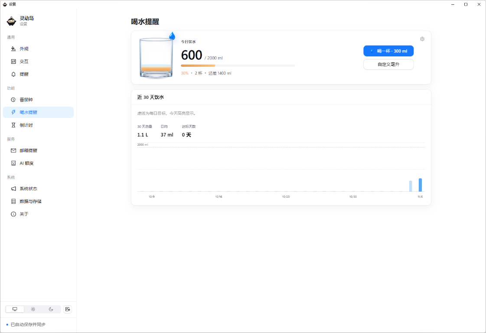

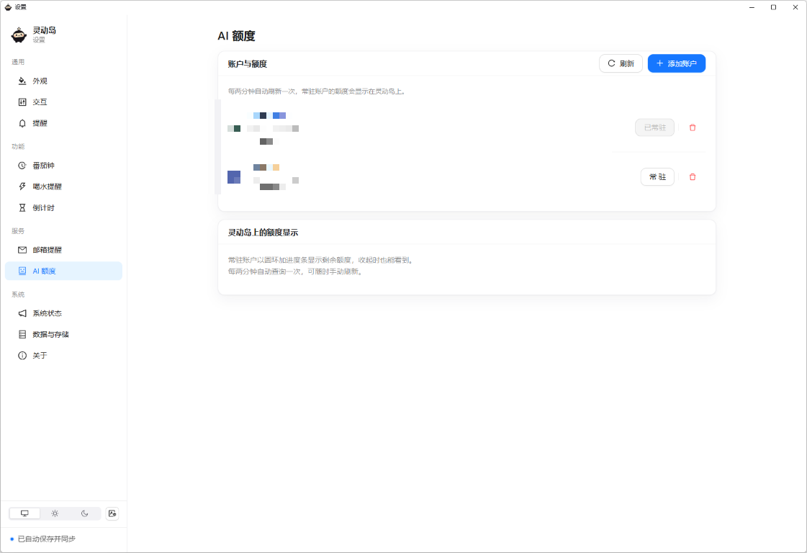

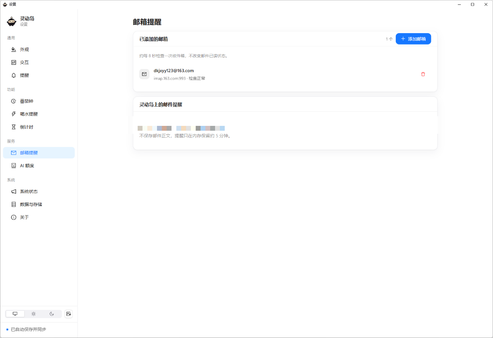

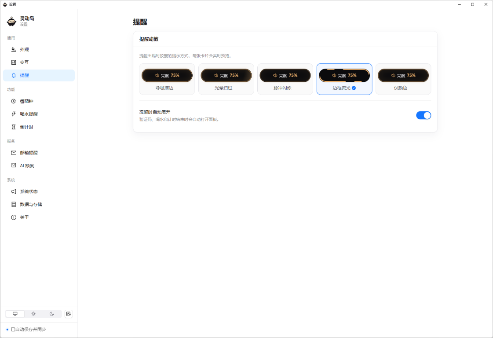

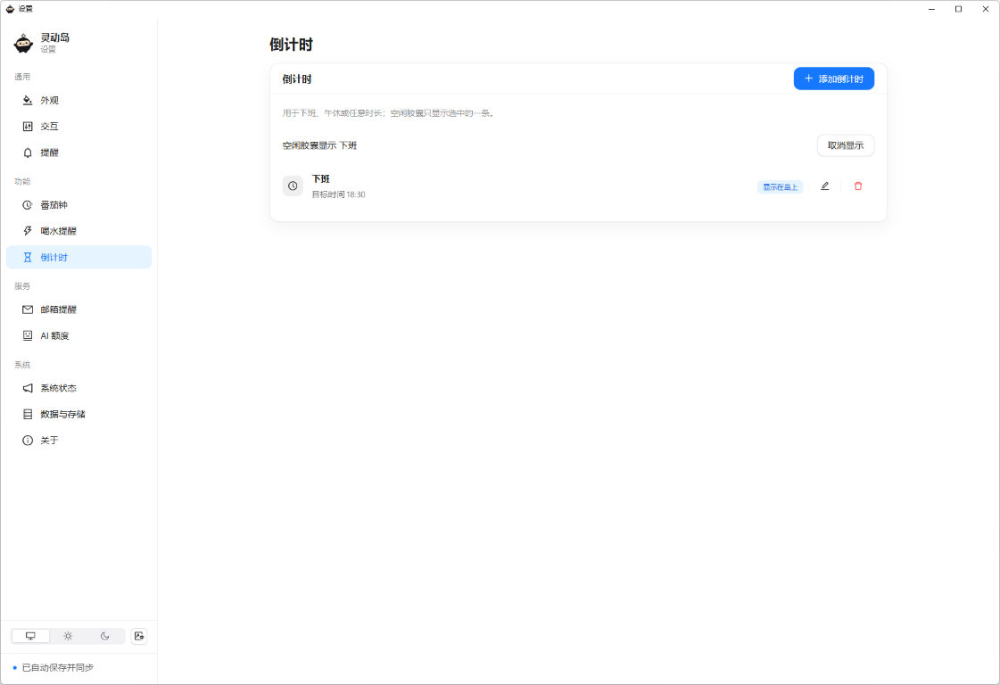

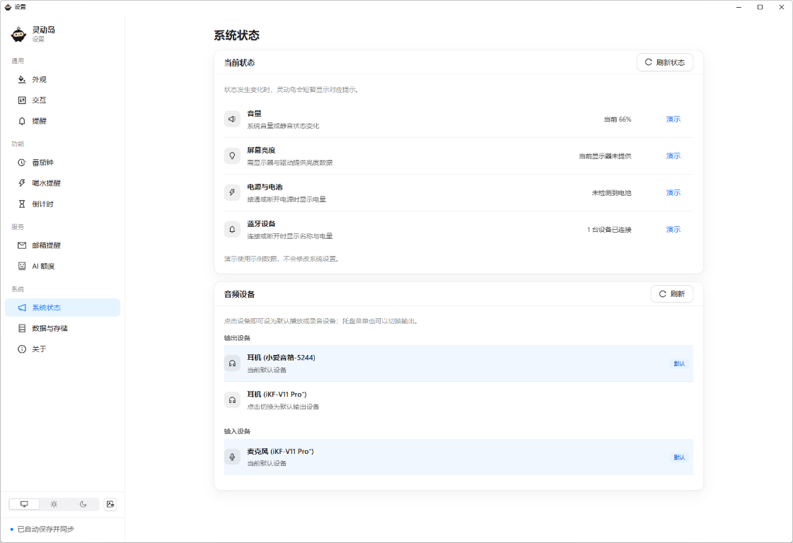

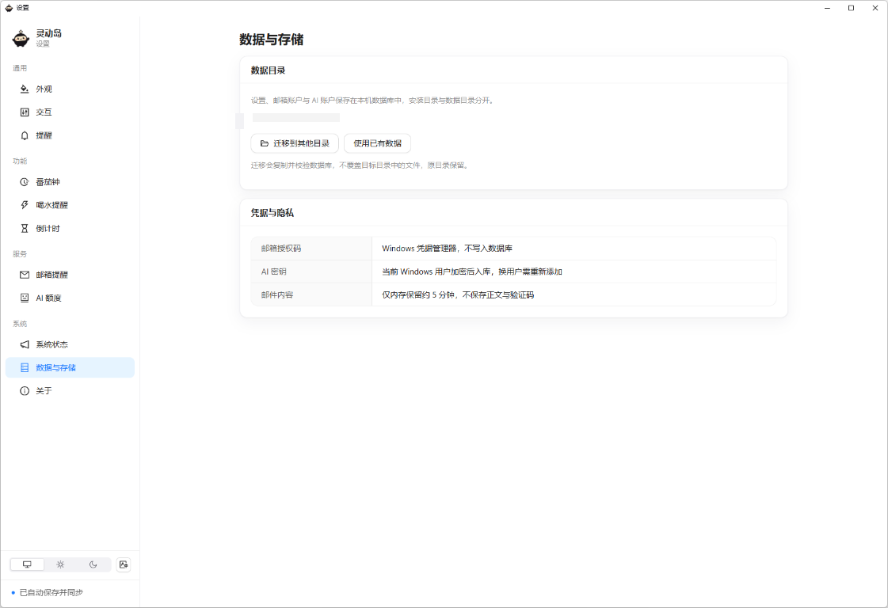

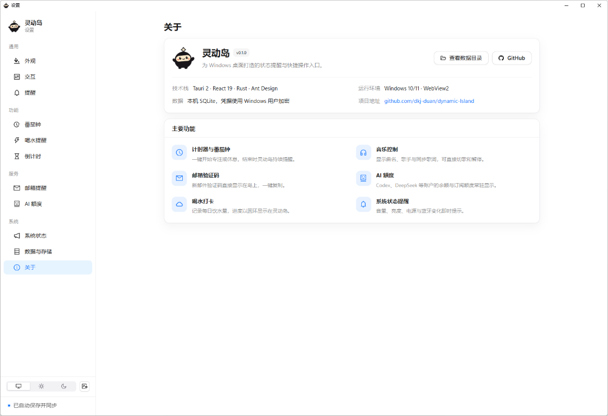

</details>

## 快速开始

### 环境要求

- Windows 10 / 11，需要 [Microsoft Edge WebView2 运行时](https://developer.microsoft.com/microsoft-edge/webview2/)（Windows 11 已内置）
- Node.js 20+ 与 npm
- Rust stable 与 [Tauri 2 的 Windows 构建依赖](https://v2.tauri.app/start/prerequisites/)（含 Microsoft C++ Build Tools 与 Windows SDK）

### 运行

```powershell
npm ci
npm run tauri dev
```

启动后屏幕顶部出现灵动岛，同时打开设置窗口。关闭设置窗口只是隐藏，可从灵动岛标题栏的设置图标重新打开。

### 构建安装包

```powershell
npm run tauri build
```

产物为 NSIS 安装包（`src-tauri/target/release/bundle/nsis`），安装时可选择目录；应用数据目录与安装目录相互独立。

### 其他命令

```powershell
npm run dev     # 仅浏览器预览，不涉及真实媒体、透明窗口与本地数据
npm run check   # prettier + eslint + vitest + tsc + vite build
```

## 使用说明

### 交互与外观

点击胶囊或悬停展开（在「设置 → 交互」里切换），拖动面板顶部可移动灵动岛，「恢复默认位置」会回到主屏顶部居中。展开面板每一页高度随内容自适应，「立即」表示鼠标离开面板就收起。滚轮与两侧箭头可以切页，设备页等长列表也不会出现滚动条。交互页还可以开启「开机自启动」：开机启动只显示灵动岛，不弹设置窗口。调整设置后会立即同步到灵动岛。

### 番茄钟

专注 / 短休 / 长休三段可分别配置时长，达到设定轮数后下一次休息自动使用长休。只有自然结束的专注才计入统计，手动取消不计。今日完成数与近 30 天专注情况保存在本地。展开的计时器页可以启动「设置 → 倒计时」里配置的时长倒计时，或输入临时 mm:ss；倒计时设置支持目标时间（如下班 18:00）和固定时长，并可选一条显示在空闲胶囊。运行中的番茄、临时计时器和倒计时会跨应用重启恢复；关闭期间已经结束的只恢复为已结束，不会补记番茄。计时结束目前没有声音，岛上会保持提醒直到确认。

### 喝水

设置每日目标、每杯容量、提醒间隔与提醒时段。到达间隔且当天未达标时，灵动岛出现提醒与喝水动画；提醒只出现在岛上，不弹系统通知。展开喝水页可一键记录一杯或输入自定义毫升数，颜色随完成度从琥珀、天蓝过渡到绿色；设置页可查看近 30 天记录并单独重置今天。

### 音乐与歌词

读取 Windows 当前媒体会话，显示封面（播放时旋转）、曲名、艺人、同步歌词与可拖动进度，并提供上一首 / 播放暂停 / 下一首。歌词按歌名、歌手和时长向网易云音乐与 LRCLIB 查询；未找到、无时间戳或网络失败会分别提示，不会伪造同步结果。

「岛上歌词」开启时，收起胶囊显示歌名和当前歌词；没有媒体播放时不显示音乐组件（设置页预览用示例曲目演示位置）。网易云客户端不提供系统时间轴时，会只读本地播放事件日志或已验证版本的时间轴作为回退，该进度不保证可以拖动。

### 邮箱提醒

支持网易 163 / 126、QQ、Gmail 和自定义 IMAP，仅使用 TLS，暂不支持需要 OAuth 的账户。应用在收件箱建立基线后约每 8 秒检查一次新邮件，不改动已读状态：识别到验证码时直接在收起胶囊上显示数字并提供复制，停留到复制或展开为止（最长 2 分钟）；普通邮件显示主题。验证码识别基于文本规则，可能有遗漏或误识别，请以邮件内容为准。

### AI 额度

支持多账户并选择一个常驻灵动岛，每两分钟自动刷新：

| 服务       | 数据来源                                               |
| ---------- | ------------------------------------------------------ |
| Codex      | 本机已登录的 Codex CLI（ChatGPT 周期额度，含重置时间） |
| Kimi Code  | 本机已启动并登录的本地服务（需端口与访问令牌）         |
| DeepSeek   | API 账户余额                                           |
| MiniMax    | Token Plan（中国区 / 国际区）                          |
| OpenRouter | 账户积分（需管理密钥）                                 |

订阅额度用同心圆环展示，单指标时百分比显示在环内；货币余额按金额显示，不推算百分比。只展示服务实际返回的数据，接口缺失或失败时显示错误，不假设满额。

### 系统状态提醒

音量、显示器亮度、电源连接、蓝牙连接和默认音频设备发生变化时会短暂接管灵动岛，随后恢复原有内容。亮度依赖显示器与驱动提供的 WMI 数据，外接显示器可能不支持；蓝牙电量优先读取系统 BatteryLife，经典蓝牙耳机则从 Hands-Free 节点的电量指示读取，设备未上报时自动隐藏。启动时先建立基线，不会提示已有状态；「设置 → 系统状态」可刷新读数或用示例数据演示。

「设置 → 系统状态」和托盘右键菜单都能列出并切换默认输出设备；灵动岛「设备」页同时列出输出与麦克风输入设备，点击即可设为默认。设备枚举使用公开的 Core Audio 接口，切换默认设备依赖 Windows 未公开的 PolicyConfig 接口（Win10/11 通用），失败时会保留原设备并显示错误。

## 数据与隐私

- 设置、邮箱账户、邮件游标、AI 账户与每日统计存放于 SQLite。
- 邮箱授权码保存在 Windows 凭据管理器，不写入数据库；AI 密钥与本地服务令牌经 Windows DPAPI 用当前用户身份加密后入库。
- 不保存邮件正文与验证码；邮件提醒仅在内存保留约 5 分钟。
- 「设置 → 数据与存储」可迁移数据目录或复用已有数据库，迁移不会覆盖目标目录中已有的数据库，原目录文件保留。复制数据库到其他 Windows 用户或电脑后，需要重新添加邮箱授权码。

网络请求只发往功能实际需要的服务：

| 功能       | 目标                                                                                                        |
| ---------- | ----------------------------------------------------------------------------------------------------------- |
| 歌词       | `music.163.com`、`lrclib.net`；封面来自 `p1.music.126.net`                                                  |
| AI 额度    | `api.deepseek.com`、`openrouter.ai`、`www.minimaxi.com`、`www.minimax.io`                                   |
| Kimi       | 仅本机 `127.0.0.1` 上的 Kimi 服务，不经过外网                                                               |
| 邮箱       | 你填写的 IMAP 服务器；预置 `imap.163.com`、`imap.126.com`、`imap.yeah.net`、`imap.qq.com`、`imap.gmail.com` |
| 网易云回退 | 只读取本机客户端日志，不上传                                                                                |

应用不包含遥测、崩溃上报或自动更新检查；除上述功能请求外不会主动联网。

## 已知限制

- 灵动岛停靠在主显示器顶部，可拖动，但尚无全屏避让与多屏分别摆放。
- 倒计时按自然日计算：目标时间过点后显示“已到”，次日重新开始。
- 只有 Codex 返回重置时间，其余服务的接口没有该字段，因此不显示。
- 插件机制尚未实现。
- 浏览器预览（`npm run dev`）只用于调样式，不保存设置，也不调用任何 Windows 能力。
- 安装包未做代码签名，也没有内置自动更新；Windows SmartScreen 可能提示未知发布者。

## 开发

### 项目结构

```
src/features   两套窗口（island / main）的界面与交互
src/domain     纯业务逻辑（番茄钟、喝水、额度、显示优先级……）
src/services   Tauri 命令封装、存储与显示适配
src/styles     设计 token、灵动岛与设置页样式
src-tauri/src  Rust：窗口、系统状态、音频、媒体、歌词、IMAP、AI 额度、SQLite
docs/          架构、开发与路线图文档
```

### 提交前检查

```powershell
npm run check
cargo fmt --manifest-path src-tauri/Cargo.toml -- --check
cargo clippy --manifest-path src-tauri/Cargo.toml --all-targets -- -D warnings
cargo test --manifest-path src-tauri/Cargo.toml
```

窗口、字体、媒体与额度相关的改动还需要在真实 Windows 桌面上验收（透明区域、点击穿透、DPI 缩放、实际播放器）。

更多设计说明见 [技术架构](docs/architecture.md)，开发约定见 [开发规范](docs/development.md)，发布步骤见[发布流程](docs/release.md)。

## 贡献

欢迎提交 Issue 与 Pull Request。开始前请阅读：

- [贡献指南](CONTRIBUTING.md)：环境搭建、改动范围、测试与提交要求。
- [行为准则](CODE_OF_CONDUCT.md)：参与社区时的基本约定。
- [安全策略](SECURITY.md)：漏洞请私下报告，不要在公开 Issue 中贴出凭据或利用细节。
- [路线图](docs/roadmap.md) 与 [变更日志](CHANGELOG.md)：了解计划中的功能和版本变化。

## 第三方与许可

项目代码以 [MIT 许可](LICENSE)发布，Copyright (c) 2026 dkj。

- 网易云音乐时间轴适配参考了岛仔项目，许可见 [`src-tauri/DAOZAI-LICENSE.txt`](src-tauri/DAOZAI-LICENSE.txt)。
- AI 服务图标及其归属见 [`src/assets/ai/ATTRIBUTION.txt`](src/assets/ai/ATTRIBUTION.txt)。
- 应用图标、吉祥物与界面插图为本项目原创，随项目以 MIT 许可发布。
- 其余第三方依赖的许可证以其各自仓库为准。
